<!-- COLD OPEN HERO -->
<picture>
  <source media="(prefers-color-scheme: dark)"  srcset="assets/cold-open-dark.svg">
  <source media="(prefers-color-scheme: light)" srcset="assets/cold-open-light.svg">
  
</picture>

  

<!-- SYNOPSIS -->
<picture>
  <source media="(prefers-color-scheme: dark)"  srcset="assets/synopsis-dark.svg">
  <source media="(prefers-color-scheme: light)" srcset="assets/synopsis-light.svg">
  
</picture>

  

<!-- NOW SHOWING: POSTER 1 - NEXTIME -->
<a href="https://nextime-omega.vercel.app/" target="_blank" rel="noopener noreferrer">
  <picture>
    <source media="(prefers-color-scheme: dark)"  srcset="assets/posters/nextime-dark.svg">
    <source media="(prefers-color-scheme: light)" srcset="assets/posters/nextime-light.svg">
    
  </picture>
</a>

  

<!-- NOW SHOWING: POSTER 2 - STUDENT MANAGEMENT SYSTEM -->
<a href="https://github.com/Satvik-4web/laravelapp" target="_blank" rel="noopener noreferrer">
  <picture>
    <source media="(prefers-color-scheme: dark)"  srcset="assets/posters/student-management-dark.svg">
    <source media="(prefers-color-scheme: light)" srcset="assets/posters/student-management-light.svg">
    
  </picture>
</a>

  

<!-- NOW SHOWING: POSTER 3 - WASTE MANAGEMENT SYSTEM -->
<a href="https://github.com/Satvik-4web/dbms-project" target="_blank" rel="noopener noreferrer">
  <picture>
    <source media="(prefers-color-scheme: dark)"  srcset="assets/posters/waste-management-dark.svg">
    <source media="(prefers-color-scheme: light)" srcset="assets/posters/waste-management-light.svg">
    
  </picture>
</a>

  

<!-- NOW SHOWING: POSTER 4 - CAMPUSVERSE -->
<a href="https://github.com/Satvik-4web/campus-verse" target="_blank" rel="noopener noreferrer">
  <picture>
    <source media="(prefers-color-scheme: dark)"  srcset="assets/posters/campusverse-dark.svg">
    <source media="(prefers-color-scheme: light)" srcset="assets/posters/campusverse-light.svg">
    
  </picture>
</a>

  

<!-- NOW SHOWING: POSTER 5 - BANKNOTE AUTHENTICATION -->
<a href="https://github.com/Satvik-4web/banknote-authentication-machine-learning" target="_blank" rel="noopener noreferrer">
  <picture>
    <source media="(prefers-color-scheme: dark)"  srcset="assets/posters/banknote-dark.svg">
    <source media="(prefers-color-scheme: light)" srcset="assets/posters/banknote-light.svg">
    
  </picture>
</a>

  

<!-- END CREDITS: TECHNICAL CAST -->
<picture>
  <source media="(prefers-color-scheme: dark)"  srcset="assets/credits-dark.svg">
  <source media="(prefers-color-scheme: light)" srcset="assets/credits-light.svg">
  
</picture>

  

<!-- BEHIND THE SCENES: PRODUCTION STATS SLATE -->
<picture>
  <source media="(prefers-color-scheme: dark)"  srcset="assets/production-stats-dark.svg">
  <source media="(prefers-color-scheme: light)" srcset="assets/production-stats-light.svg">
  
</picture>

  

<!-- END CARD -->
<picture>
  <source media="(prefers-color-scheme: dark)"  srcset="assets/end-card-dark.svg">
  <source media="(prefers-color-scheme: light)" srcset="assets/end-card-light.svg">
  
</picture>

  

  <a href="#now-showing">PROJECTS</a> &nbsp;&bull;&nbsp; 
  <a href="https://nextime-omega.vercel.app/" target="_blank" rel="noopener noreferrer">LIVE DEMO</a> &nbsp;&bull;&nbsp; 
  <a href="https://github.com/Satvik-4web?tab=repositories" target="_blank" rel="noopener noreferrer">REPOSITORIES</a>

  

---

  
<b>Plain Text Synopsis &amp; Production Catalogue (Accessibility &amp; Fallback)</b>

   

  ### Identity &amp; Synopsis
  - **Name:** Satvik (GitHub: [`Satvik-4web`](https://github.com/Satvik-4web))
  - **Education:** Computer Engineering student at Thapar Institute of Engineering &amp; Technology (TIET), Patiala &bull; Graduating 2028.
  - **Role:** Co-founder &amp; CTO of a dev agency.
  - **Engineering Focus:** Building resilient full-stack architectures and advancing into AI engineering (LLM APIs, retrieval-augmented generation pipelines, vector search).
  - **Motto:** `BUILD → BREAK → LEARN → REBUILD`

  ---

  ### Feature Catalogue (Now Showing)
  1. **[NexTime](https://github.com/Satvik-4web/Nextime)** &bull; [Live Application](https://nextime-omega.vercel.app/)
     - *Overview:* Student Operating System built around dynamic timetable scheduling. Features live current/next class detection, free-slot intelligence, multi-tier attendance monitoring (critical &lt;75%, warning 75&ndash;80%, safe &gt;80%), assignment tracker, 45/10/20 Pomodoro focus mode, CGPA forecaster, friend schedule viewer, realtime community hub, and installable PWA.
     - *Stack:* Next.js 14, React, TypeScript, Tailwind CSS, Framer Motion, Zustand, Supabase (PostgreSQL + Realtime), Upstash Redis, Vercel.

  2. **[Student Management System](https://github.com/Satvik-4web/laravelapp)**
     - *Overview:* Decoupled role-based educational administration platform. Enforces strict backend authorization across 5 roles (Admin, Principal, HOD, Faculty, Student) via Laravel Sanctum bearer tokens, token revocation on credential changes, full student CRUD operations, and verified Postman test collection.
     - *Stack:* Laravel, PHP, SQLite, Next.js, React, TypeScript, Tailwind CSS.

  3. **[Waste Management System](https://github.com/Satvik-4web/dbms-project)**
     - *Overview:* Relational database management architecture for municipal waste logistics. Implements normalized schemas (3NF/BCNF), Oracle PL/SQL stored procedures, functions, cursors, automated validation triggers (capacity check &amp; quota limits), and ACID transaction rollbacks.
     - *Stack:* Oracle Database, PL/SQL, Node.js, Express, JavaScript.

  4. **[CampusVerse](https://github.com/Satvik-4web/campus-verse)**
     - *Overview:* Interactive digital kiosk and augmented reality campus navigation platform funded through TIET's Experiential Learning Centre (ELC).
     - *Stack:* WebXR / AR, Three.js / WebGL, TypeScript.

  5. **[Banknote Authentication](https://github.com/Satvik-4web/banknote-authentication-machine-learning)**
     - *Overview:* Machine learning pipeline benchmarking multiple classification algorithms on statistical image wavelet features (variance, skewness, curtosis, entropy) to classify genuine and counterfeit banknotes.
     - *Stack:* Python, scikit-learn, NumPy, Pandas.

  ---

  ### Also in the Catalogue (Other Public Repositories)
  - **[`SceneNav-AI`](https://github.com/Satvik-4web/SceneNav-AI):** Autonomous navigation and spatial scene comprehension.
  - **[`samsung-prism-streaming-rag`](https://github.com/Satvik-4web/samsung-prism-streaming-rag):** Real-time streaming retrieval-augmented generation pipeline.
  - **[`smart-library-seat-management`](https://github.com/Satvik-4web/smart-library-seat-management):** Automated library seating allocation system.
  - **[`sovaraAI`](https://github.com/Satvik-4web/sovaraAI) &amp; [`sovara-ai-workbench`](https://github.com/Satvik-4web/sovara-ai-workbench):** AI experimentation workbench and model exploration.
  - **[`5G-Lab-Room`](https://github.com/Satvik-4web/5G-Lab-Room):** Telecommunications laboratory management and resource tracking.
  - **[`DSA-Codes`](https://github.com/Satvik-4web/DSA-Codes) &amp; [`leetcode-codes`](https://github.com/Satvik-4web/leetcode-codes):** Algorithmic implementations and data structure solutions.

  ---

  ### Technical Cast (Stack &amp; Tools)
  - **Languages:** Python, TypeScript, JavaScript, C++, PHP, C#
  - **Frameworks &amp; Platforms:** Next.js 14, React, Node.js, Express, Laravel, Tailwind CSS
  - **Data &amp; Storage:** PostgreSQL, Supabase Realtime, Upstash Redis, Oracle Database, SQLite
  - **Machine Learning &amp; AI:** scikit-learn, NumPy, Pandas, LLM APIs, RAG Pipelines, Vector Search
  - **Tools:** Git, GitHub Actions, Docker, Postman, VS Code, Linux / Bash

