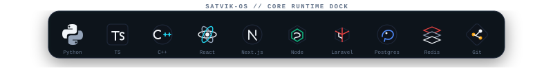

  <picture>
    <source media="(prefers-color-scheme: dark)" srcset="assets/boot-dark.svg">
    <source media="(prefers-color-scheme: light)" srcset="assets/boot-light.svg">
    
  </picture>

 

  <picture>
    <source media="(prefers-color-scheme: dark)" srcset="assets/desktop-dark.svg">
    <source media="(prefers-color-scheme: light)" srcset="assets/desktop-light.svg">
    
  </picture>

 

  <a href="#processes"><code>[ processes ]</code></a> &nbsp;&bull;&nbsp;
  <a href="https://nextime-omega.vercel.app/"><code>[ live demo ]</code></a> &nbsp;&bull;&nbsp;
  <a href="https://github.com/Satvik-4web?tab=repositories"><code>[ repositories ]</code></a> &nbsp;&bull;&nbsp;
  <a href="#system-monitor"><code>[ system monitor ]</code></a>

 

<h2 id="processes" align="center">Processes</h2>

<!-- 1. NexTime -->

  <a href="https://nextime-omega.vercel.app/">
    <picture>
      <source media="(prefers-color-scheme: dark)" srcset="assets/cards/nextime-dark.svg">
      <source media="(prefers-color-scheme: light)" srcset="assets/cards/nextime-light.svg">
      
    </picture>
  </a>

  <code><a href="https://github.com/Satvik-4web/Nextime">Satvik-4web/Nextime</a> &bull; <a href="https://nextime-omega.vercel.app/">Launch Web App ↗</a> &bull; Next.js 14, TypeScript, Supabase, Tailwind, Redis</code>

 

<!-- 2. Student Management System -->

  <a href="https://github.com/Satvik-4web/laravelapp">
    <picture>
      <source media="(prefers-color-scheme: dark)" srcset="assets/cards/student-management-dark.svg">
      <source media="(prefers-color-scheme: light)" srcset="assets/cards/student-management-light.svg">
      
    </picture>
  </a>

  <code><a href="https://github.com/Satvik-4web/laravelapp">Satvik-4web/laravelapp</a> &bull; Laravel, PHP, Next.js, TypeScript, Sanctum, SQLite</code>

 

<!-- 3. Waste Management System -->

  <a href="https://github.com/Satvik-4web/dbms-project">
    <picture>
      <source media="(prefers-color-scheme: dark)" srcset="assets/cards/waste-management-dark.svg">
      <source media="(prefers-color-scheme: light)" srcset="assets/cards/waste-management-light.svg">
      
    </picture>
  </a>

  <code><a href="https://github.com/Satvik-4web/dbms-project">Satvik-4web/dbms-project</a> &bull; Oracle, PL/SQL, Node.js, Express, 3NF/BCNF, ACID</code>

 

<!-- 4. CampusVerse -->

  <a href="https://github.com/Satvik-4web/campus-verse">
    <picture>
      <source media="(prefers-color-scheme: dark)" srcset="assets/cards/campusverse-dark.svg">
      <source media="(prefers-color-scheme: light)" srcset="assets/cards/campusverse-light.svg">
      
    </picture>
  </a>

  <code><a href="https://github.com/Satvik-4web/campus-verse">Satvik-4web/campus-verse</a> &bull; JavaScript, WebAR/VR, 3D Kiosk, TIET ELC Funded</code>

 

<!-- 5. Banknote Authentication -->

  <a href="https://github.com/Satvik-4web/banknote-authentication-machine-learning">
    <picture>
      <source media="(prefers-color-scheme: dark)" srcset="assets/cards/banknote-dark.svg">
      <source media="(prefers-color-scheme: light)" srcset="assets/cards/banknote-light.svg">
      
    </picture>
  </a>

  <code><a href="https://github.com/Satvik-4web/banknote-authentication-machine-learning">Satvik-4web/banknote-authentication-machine-learning</a> &bull; Python, scikit-learn, Pandas, NumPy</code>

 

<!-- Dock: Runtime Tech Stack -->

  <picture>
    <source media="(prefers-color-scheme: dark)" srcset="assets/dock-dark.svg">
    <source media="(prefers-color-scheme: light)" srcset="assets/dock-light.svg">
    
  </picture>

 

<!-- System Monitor Panel -->

  <picture>
    <source media="(prefers-color-scheme: dark)" srcset="assets/monitor-dark.svg">
    <source media="(prefers-color-scheme: light)" srcset="assets/monitor-light.svg">
    
  </picture>

 

<!-- Terminal Shutdown Footer -->

  <picture>
    <source media="(prefers-color-scheme: dark)" srcset="assets/shutdown-dark.svg">
    <source media="(prefers-color-scheme: light)" srcset="assets/shutdown-light.svg">
     BREAK -> LEARN -> REBUILD" src="assets/shutdown-dark.svg" width="100%">
  </picture>

 

<!-- Accessibility & SEO Fallback -->

  
<strong>Plain Text Terminal Readout (Accessibility &amp; Screen Reader Fallback)</strong>

   

### Identity
- **Name:** Satvik (GitHub: Satvik-4web)
- **Role:** Computer Engineering Student &amp; Dev Agency Co-founder / CTO
- **Institution:** Thapar Institute of Engineering &amp; Technology (TIET), Patiala (Class of 2028)
- **Focus:** Full-stack systems architecture transitioning into AI engineering (LLM APIs, RAG pipelines, Vector Search)
- **Philosophy:** `BUILD → BREAK → LEARN → REBUILD`

### Featured Projects
1. **NexTime** ([Repository](https://github.com/Satvik-4web/Nextime) | [Live Demo](https://nextime-omega.vercel.app/))
   - "Student OS": timetable-first platform with live class &amp; free-slot detection, attendance tracking threshold (&gt;80% safe, &lt;75% critical), Pomodoro focus timer (45/10/20), CGPA forecasting, and realtime community.
   - Stack: Next.js 14, React, TypeScript, Tailwind, Framer Motion, Zustand, Supabase (Postgres + Realtime), Upstash Redis, Vercel.
2. **Student Management System** ([Repository](https://github.com/Satvik-4web/laravelapp))
   - Laravel REST API with Sanctum bearer-token authentication, 5-tier role-based access control (Admin, Principal, HOD, Faculty, Student) enforced by backend route middleware, token revocation, student CRUD API, and Postman collection.
   - Stack: Laravel, PHP, SQLite, Next.js, React, TypeScript, Tailwind.
3. **Waste Management System** ([Repository](https://github.com/Satvik-4web/dbms-project))
   - Normalized relational schema (3NF/BCNF) in Oracle PL/SQL with automated capacity and quantity validation triggers, ACID transaction guarantees, and Node.js Express API.
   - Stack: Oracle, PL/SQL, Node.js, Express, JavaScript.
4. **CampusVerse** ([Repository](https://github.com/Satvik-4web/campus-verse))
   - Interactive AR/VR digital kiosk and student platform funded through TIET's Experiential Learning Centre (ELC).
   - Stack: JavaScript, WebAR/VR, 3D Kiosk, Interactive Web.
5. **Banknote Authentication** ([Repository](https://github.com/Satvik-4web/banknote-authentication-machine-learning))
   - Comparative machine learning evaluation analyzing multiple classification algorithms on banknote statistical wavelet features.
   - Stack: Python, scikit-learn, NumPy, Pandas.

